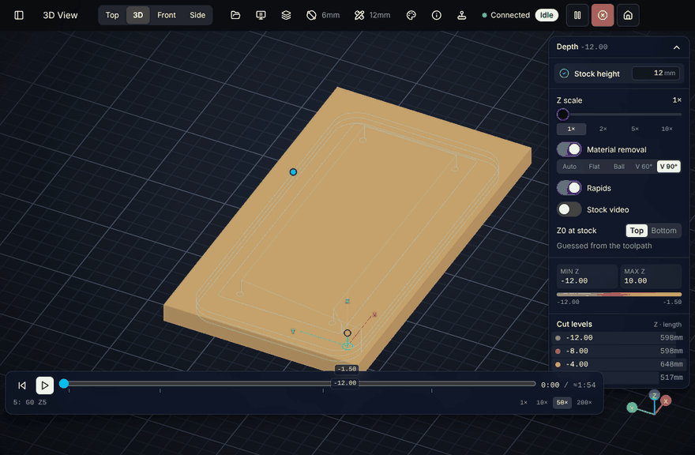
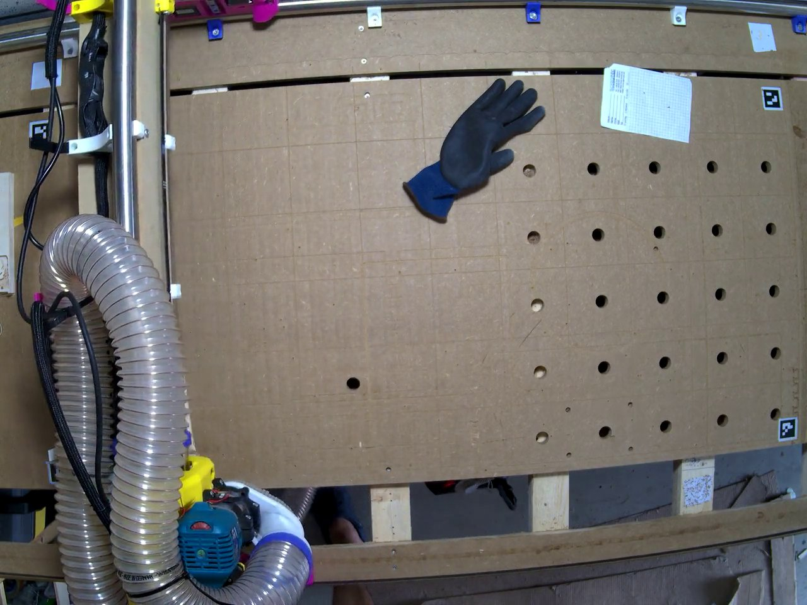
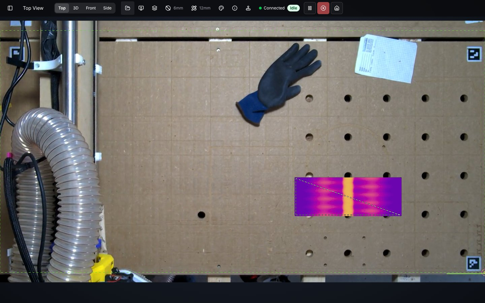
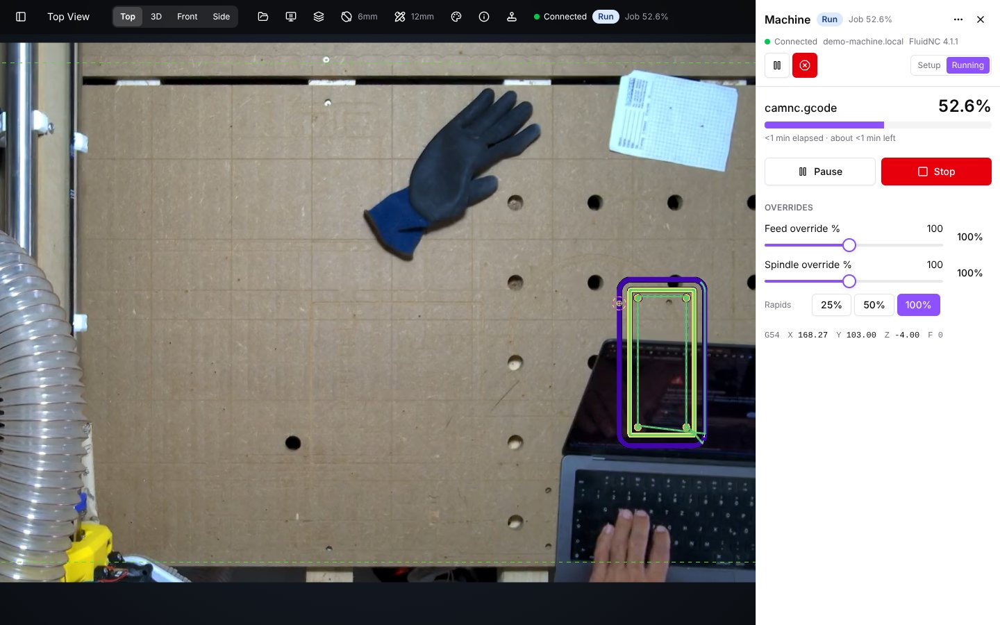
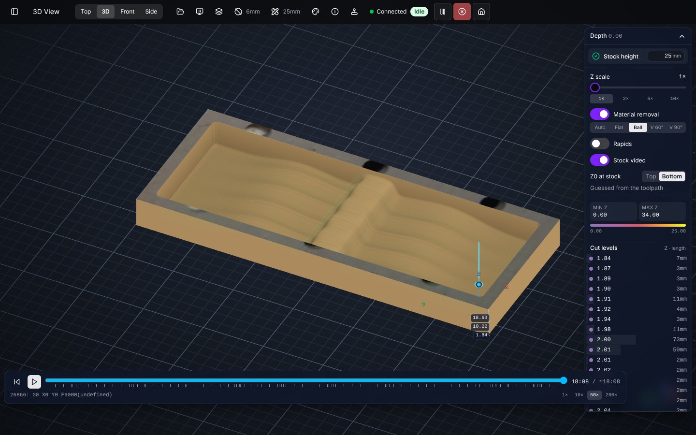
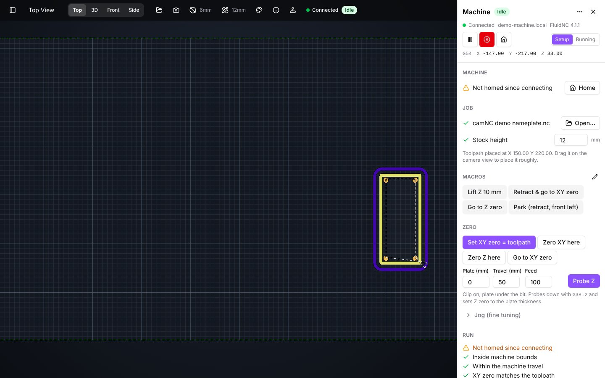

<div align="center">

# camNC

**See your CNC toolpath on the real machine bed. Then cut it.**

[](https://run.camnc.app/demo)
[](#desktop-app-recommended)
[](#run-the-job-from-the-same-screen)



_Material removal preview, scrubbing through the job with a 90° V-bit_

</div>

camNC shows your CNC toolpath on a live camera image of the machine bed, so you can check stock placement, offsets and
clamps before the spindle starts. It also runs the job: connect to FluidNC, zero, probe and start from the same screen,
and preview the cut in 3D first.

camNC is built for the [V1 Engineering LowRider V4](https://docs.v1e.com/lowrider/) running FluidNC, and that is the
machine it is tested on. It should work just as well on other FluidNC machines.

[](https://www.youtube.com/watch?v=KKgJ9J6dmqE)

_Cutting a small oak board with camNC (YouTube)_

This repository is a pnpm/Turborepo monorepo with the camNC app, its desktop version and the supporting packages.

## See the toolpath where it will cut

Mount a camera above the machine (an old phone, a webcam or an IP camera) and print four ArUco markers. camNC calibrates
the camera with OpenCV, finds its pose from the markers and corrects lens distortion and perspective, so you get a
top-down view in machine coordinates with the G-code drawn on top. Drag the toolpath onto the stock and check clamps and
offsets before the spindle starts.

| Camera image (wide-angle lens, rotated to match)                                                                       | camNC top view of the same frame, with the toolpath                                                                                    |
| ---------------------------------------------------------------------------------------------------------------------- | -------------------------------------------------------------------------------------------------------------------------------------- |
|  |  |

## Run the job from the same screen

camNC talks to FluidNC (3.9.9 and 4.1.x) directly. Home, jog, set XY zero to the toolpath, probe Z and run the job from
the SD card. A checklist catches a missed home or probe, and a green line on the camera image shows how far the job has
got. Feed and spindle overrides, macros and a console are one click away.



## Preview the cut in 3D

The 3D, front and side views simulate the stock being cut with flat, ball and V-bits. Scrub through the job on the
timeline, scale Z to spot shallow passes, and project the camera image onto the stock.



## No camera yet?

Start with just FluidNC. camNC draws the bed from the machine size it reports, with a 10 mm grid in machine coordinates,
and you can jog, preview and run jobs right away. Add a camera later.



## Hide the machine

This experimental feature estimates monocular depth with the Depth Anything V2 model and masks everything above the work
surface, so the gantry disappears from the image (only tested with the [LowRider V4 beam](https://docs.v1e.com/lowrider/)).
It assumes the largest depth cluster is the table and masks everything above a configurable offset:

https://github.com/user-attachments/assets/a89cd4fe-92ce-4c37-b2a1-7ad5d3012fee

## How accurate is it?

Three crosses engraved one after another, each positioned by drag-and-drop on the camera image. Y is off by 1–2 mm, X
lines up well. The setup used an old Pixel 5 on a ~120×60 cm [MPCNC LowRider V4](https://docs.v1e.com/lowrider/), with a
reprojection error of around 2:

https://github.com/user-attachments/assets/0c16f067-9cb2-4bc9-9941-f04e23f4bc24

## Getting started

**Try it first:** the [demo](https://run.camnc.app/demo) runs in your browser with a recorded machine camera, a sample
job and a simulated FluidNC. You can load your own G-code, and nothing is saved.

To use camNC with your own machine, pick one of these:

### Desktop app (recommended)

Download the installer for your computer:

- [macOS (Apple silicon)](https://github.com/Schibum/camNC/releases/latest/download/camNC-macOS-AppleSilicon.dmg)
- [Windows (64-bit)](https://github.com/Schibum/camNC/releases/latest/download/camNC-Windows-x64-setup.exe)
- [Linux (64-bit, `.deb`)](https://github.com/Schibum/camNC/releases/latest/download/camNC-Linux-x64.deb)

These always point to the newest build; all versions are on the
[releases page](https://github.com/Schibum/camNC/releases).

The desktop app is camNC with its own Chromium built in. It finds IP cameras on your network (ONVIF, or any camera with
RTSP) and connects to them directly, so you don't need a Raspberry Pi, go2rtc or any other gateway. It also talks to
FluidNC without browser restrictions and works offline. On macOS and Windows it updates itself in the background (the
update is used after the next restart); on Linux, install a newer `.deb` from the releases.

The app is not code-signed yet, so the first start shows a warning:

- **macOS:** open the app once, then allow it under System Settings → Privacy & Security → _Open Anyway_. Or run
  `xattr -dr com.apple.quarantine /Applications/camNC.app`.
- **Windows:** SmartScreen warns about an unknown publisher; choose _More info_ → _Run anyway_.

Settings stay on your computer; there is no sign-in or sync in the desktop app. See
[apps/camnc-desktop](apps/camnc-desktop/README.md) for building it yourself.

### In the browser

Open [run.camnc.app](https://run.camnc.app/), no install needed. Phone cameras and webcams work out of the box. For
machine control, use Chrome or Edge 147+ on the same network as the controller (FluidNC in STA mode); other browsers can
use camNC as a viewer.

Browsers can't open an IP camera's RTSP stream. To use an IP camera in the browser, run a
[go2rtc](https://github.com/AlexxIT/go2rtc) gateway that re-streams it over WebRTC, for example on a Raspberry Pi Zero
or any computer on your network, and pick the _go2rtc_ source in camNC. The desktop app makes this unnecessary.

## What you need

| Part                        | Notes                                                                                                                                                                                                                                                                                                                   |
| --------------------------- | ----------------------------------------------------------------------------------------------------------------------------------------------------------------------------------------------------------------------------------------------------------------------------------------------------------------------- |
| Camera with a top-down view | An old smartphone ([ceiling mount](https://makerworld.com/en/models/1455114-ceiling-top-down-phone-mount-with-ball-joint#profileId-1516416)), a webcam, or an IP camera such as a Reolink E1 Zoom ([mount](https://makerworld.com/en/models/1461605-reolink-e1-zoom-ceiling-down-mount-looking-down#profileId-1524062)) |
| Four ArUco markers          | Printed and fixed at known machine positions; camNC uses them to find the camera pose and keep it up to date                                                                                                                                                                                                            |
| Calibration chessboard      | Printed or shown on a screen, used once per camera during setup                                                                                                                                                                                                                                                         |
| FluidNC controller          | Optional. 3.9.9 or 4.1.x, for machine control (reference machine: V1 Engineering Jackpot2 on a LowRider V4)                                                                                                                                                                                                             |

## Repository layout

This workspace is a pnpm/Turborepo monorepo split into two top‑level folders:

- `apps/` – runnable applications.
- `packages/` – reusable libraries and config used by the apps.

See [docs/ARCHITECTURE.md](docs/ARCHITECTURE.md) for how the pieces fit together.

### Apps

- **camNC** – main camera overlay application ([run.camnc.app](https://run.camnc.app/)).
- **camnc-desktop** – the desktop app: camNC packaged with Tauri and CEF, with a go2rtc sidecar for IP cameras.
- **webrtc-cam** – runs on a phone and streams its camera to camNC via WebRTC.
- **website** – Astro landing page ([www.camnc.app](https://www.camnc.app/)).
- **chessboard** – displays/prints the chessboard pattern for camera calibration.
- **demos** – sandbox showcasing individual packages.
- **signal** – Cloudflare Worker that relays WebRTC signalling between camNC and phone cameras.

### Packages

- **camera-calibration** – React components, store and workers for calibrating a camera with OpenCV.
- **fluidnc** – direct WebSocket connection to FluidNC (transport detection, command queue, parsers, uploads), a scripted fake and the `pnpm sim` FluidNC simulator.
- **go2webrtc** – video sources (go2rtc, RTSP via the desktop app's go2rtc, phone via WebRTC, WebTorrent, webcam, URL).
- **webrtc-channel** – WebRTC peer, WebSocket signalling client and data channel helpers.
- **video-worker-utils** – helpers for processing video frames in web workers.
- **load-opencv** – loads OpenCV.js in the browser.
- **ui** – shared React UI components.
- **public-config** – shared public configuration (signalling URL).
- **eslint-config**, **typescript-config** – shared lint rules and tsconfig presets.

## Development

Requirements: Node.js (see [`.nvmrc`](.nvmrc), `^20.19` or `>=22.12`) and pnpm (version pinned in `package.json`,
e.g. via `corepack enable`).

```bash
pnpm install
# Start a single app, e.g. camNC (see apps/camNC/README.md for required env vars)
pnpm dev --filter @wbcnc/camNC
# Or start all apps at once
pnpm dev
```

Checks (also run in CI):

```bash
pnpm run check-format  # prettier (a pre-commit hook formats staged files)
pnpm run lint          # eslint
pnpm run check-types   # tsc --noEmit in every package
pnpm run test          # vitest, runs in headless Chromium via Playwright
pnpm run build
```

Tests run in the browser, so install Chromium once with `pnpm exec playwright install chromium`. Run a single
package's tests with `pnpm turbo run test --filter <package>`.
